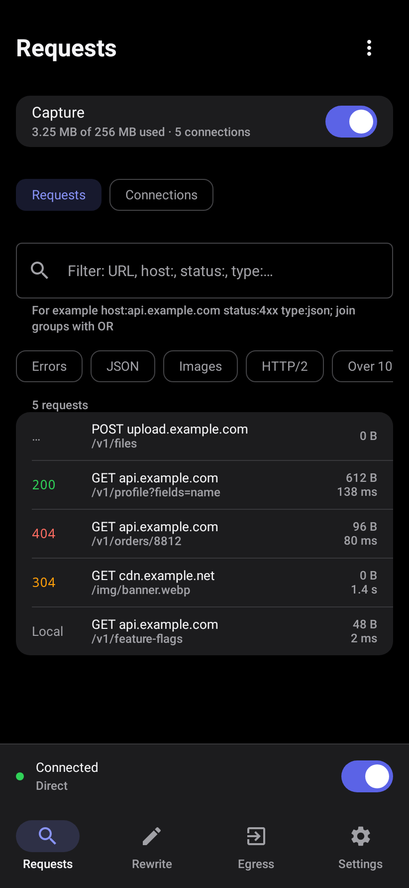
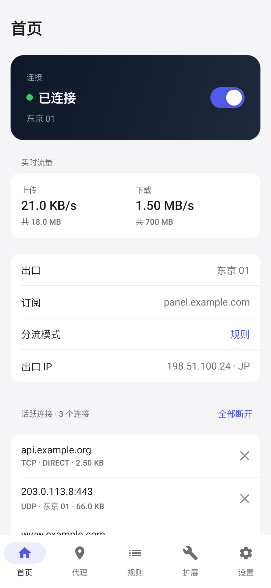
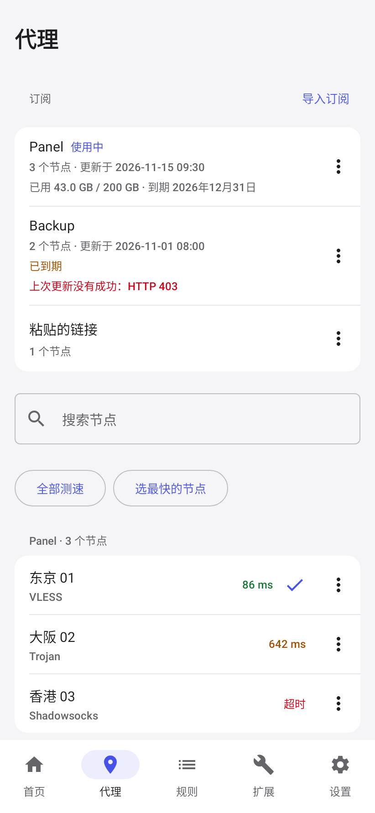
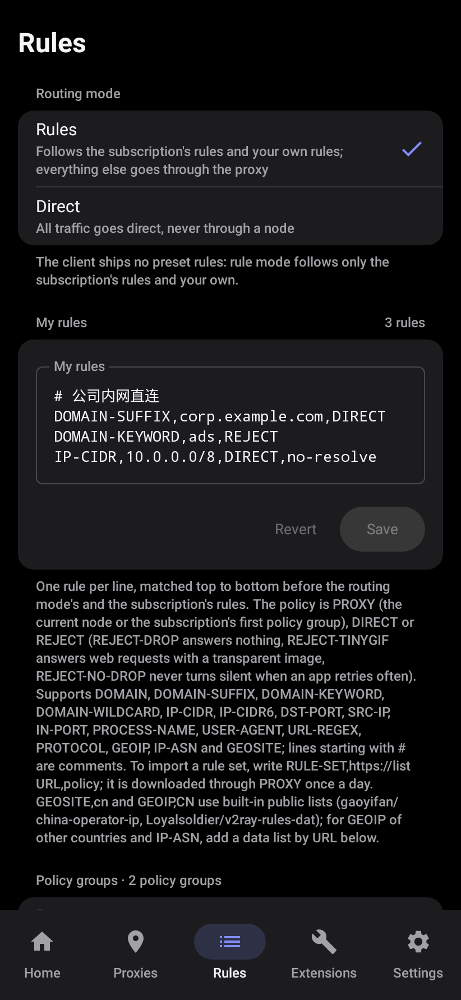
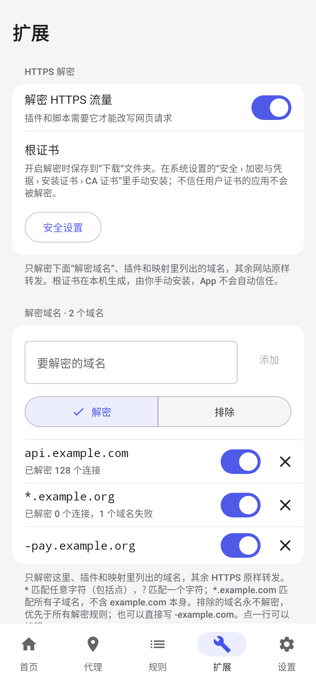
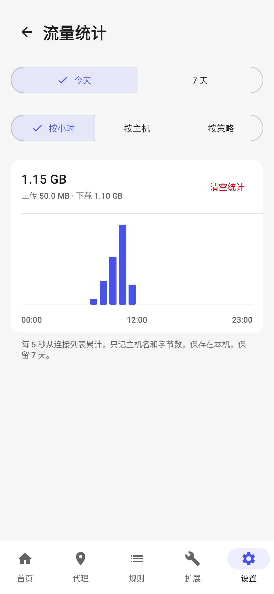

# AnixOps Net

一个 App 里的网络调试工具和代理客户端，iOS、macOS、Windows、Linux、安卓五个平台核心功能一致，
差异见[全平台功能对照](docs/platform-parity.md)。
抓包、HTTPS 解密、改写和重放放在前面，按规则分流的代理是它的底座。

[下载](https://anixops.github.io/anixops-net/) · [全部版本](https://github.com/AnixOps/anixops-net/releases) ·
[全平台功能对照](docs/platform-parity.md) · [客户端会发出哪些连接](docs/network-behavior.md)

<table>
  <tr>
    <td></td>
    <td></td>
  </tr>
</table>

## 为什么做它

调试一个 App 的网络，通常要在电脑上开一个抓包工具，手机再连一个代理客户端，两边的规则、证书和节点各配一遍。
AnixOps Net 把这两件事放进同一个 App：

- **一个 App，两种模式。** 首次启动时选“调试网络”或“代理”，设置里随时切换，订阅、节点和插件都保留。调试模式默认
  直连出口，不需要任何节点就能抓包、解密和改写；也可以改为经过自己的节点，对比不同地区的出口。
- **五个平台同一个内核。** 协议栈、规则引擎、MITM 和脚本运行时都在
  [networkcore](https://github.com/AnixOps/networkcore_anixops)，各平台固定同一个版本，所以同一条规则、同一个插件在
  手机和电脑上的结果相同。平台之间的差别来自系统限制和还没补齐的功能，都写在[功能对照](docs/platform-parity.md)里
  （系统限制见[这一节](docs/platform-parity.md#系统限制)）。
- **装好不配置，不发出任何连接。** 没有统计、遥测、广告或第三方错误上报，也不带任何预设脚本和预设分流规则：规则、
  插件和规则集都由你自己导入。

## 功能

| | |
|---|---|
| **抓包** | 一键开始、停止、清空。HTTP 请求按时间列出，带快捷筛选（出错、JSON、图片、HTTP/2、大于 100 KB 等）和表达式搜索（`host:api.example.com status:4xx type:json`，用 `OR` 组合），表达式写错时标出位置。没有解密出请求的连接也列出来，可以看原始字节（文本或十六进制）。 |
| **请求详情** | 请求和响应的头、查询参数、正文。JSON 可以折叠查看，图片直接预览，任何内容都能切到十六进制；正文自动解压（gzip、deflate、br、zstd）。SSE 和 WebSocket 逐条列出消息，HTTP/2 连接可以看两段链路的帧。 |
| **HTTPS 解密** | 按域名逐个开启，默认一个也不解密。根证书在本机生成，由你自己在系统里信任；第一次开启解密要先确认条款。解密失败时写明原因（证书固定、未信任根证书、握手超时等），可以一键排除。macOS、Windows、Linux 还能导入团队自己的根证书。 |
| **重放与导出** | 单条重放，或改方法、网址、请求头和请求体后重放。单条请求导出为 cURL、代码、Postman 或 Insomnia，默认遮住 Cookie、Authorization 和令牌类字段；整段抓包导出 pcapng 或 HAR。 |
| **改写** | Map Local（用本地内容应答）、Map Remote（转到另一个地址），可以从抓到的请求一键生成。流量重定向把指定地址、域名或端口的 TCP / UDP 流量转到你的开发服务器。 |
| **抓包会话** | 断开时自动保存；改设置导致重连前也自动保存，重连后继续抓包。也可以手动保存；会话加密存在本机，7 天后自动清理，随时载入回看。 |
| **手机连电脑抓包** | macOS、Windows、Linux 可以把代理共享到局域网，手机扫码装证书，在电脑上看手机的请求。 |
| **订阅与节点** | 导入订阅（自动更新）、分享链接或二维码；测速、选最快、策略组切换；在本机改节点名称和地址。支持 SS、SS-2022、VLESS、Trojan 等公开协议。 |
| **节点体检** | 对单个节点做几轮建连、TLS 握手和请求，给出延迟中位数、抖动和丢包；可选测下载速度（最多 200 MB）。只在你点开始时运行。目前在 iOS、macOS、安卓上提供，Windows、Linux 桌面版还没有入口。 |
| **规则与 DNS** | 规则、直连两种模式，iOS 和 macOS 另有全局模式（Windows、Linux、安卓还没有）。规则文本直接编辑，连接中原地生效；规则测试、命中次数；规则集和 GeoIP / ASN 数据按 URL 添加，缺数据时逐条提示，不会悄悄不匹配。自定义 DNS 服务器（UDP、DoQ、竞速、备用）、分域 DNS、Hosts、Fake-IP（Linux 暂不提供）、屏蔽 QUIC。 |
| **接管方式** | TUN 接管全部流量，或只设系统代理。iOS 默认 VPN 加系统代理；macOS 还可以作局域网网关；Linux 的 TUN 每次连接经 polkit 授权，App 本身不提权。 |
| **扩展** | 兼容常见插件格式的高频子集：MITM 域名、改写、脚本（JavaScript）。从网址、文件或剪贴板导入；脚本要你看过并确认后才运行：Windows、Linux、安卓导入的插件先关着，先列出它解密的域名、改写行数和脚本，打开后才生效（解密所有网站的 `*` 会醒目提示）；iOS、macOS 逐个允许插件里的脚本。 |
| **状态与诊断** | 实时流量、连接列表（可以断开单个连接）、出口地址、按天的流量统计（按主机、策略）、日志筛选、诊断报告导出、本机崩溃报告（脱敏，不上传）。 |
| **系统集成** | 系统通知、按 Wi-Fi 自动连接或断开、开机自动连接、`anixops://` 链接；iOS 有小组件和快捷指令，安卓有快捷设置磁贴。 |
| **界面** | 浅色、深色或跟随系统；简体中文、繁体中文、英文。iOS 和 macOS 是 SwiftUI，安卓是 Jetpack Compose，Windows 和 Linux 是共用的桌面界面。 |

<table>
  <tr>
    <td></td>
    <td></td>
    <td></td>
    <td></td>
  </tr>
</table>

截图来自安卓 App 的截图测试，界面改动时由 CI 一起更新，所以总是当前版本的样子。

## 安装

开源版从[下载页](https://anixops.github.io/anixops-net/)获取：

| 平台 | 安装包 | 说明 |
|---|---|---|
| Windows 10 / 11 | `.msi`（推荐）或便携版 `.zip` | 安装包还没有代码签名，SmartScreen 提示时选“更多信息 → 仍要运行”。 |
| Debian / Ubuntu | `.deb` | `sudo apt install ./<文件名>`，需要 WebKitGTK 4.1。 |
| 其他 Linux | `.tar.gz` | 解压后运行 `bin/anixops-net`，需要 WebKitGTK 4.1。 |
| 安卓 8.0 及以上 | `.apk`（arm64） | 下载后直接安装。 |

每个版本都附 `SHA256SUMS`（`sha256sum -c SHA256SUMS` 校验），并有 GitHub 来源证明：
`gh attestation verify <文件> --repo AnixOps/anixops-net`。

**ANX 版**多一个 ANX 私有协议，其余功能完全相同。它不在本仓库发布：Windows、Linux、macOS、安卓的安装包由服务商在
面板里提供，iOS / iPadOS 通过 TestFlight 分发。

## HTTPS 解密的边界

- 解密只对你加进列表的域名、启用的插件和映射声明的域名生效，排除项优先于一切。列表默认为空，App 不带任何内置名单。
- 根证书在本机生成，私钥只存在本机。App 不会替你把证书设为系统信任，要你自己确认；关闭解密时证书保留，删不删由你决定。
  Windows 只信任到当前用户，不改整台电脑的证书存储。
- 抓包内容只在本机：会话加密保存，7 天后清理。导出时默认遮住 Cookie、Authorization，以及名字带 token、secret、password、session 的头、参数和字段，导出前可以关掉。
- 系统限制照实说明：安卓 7 起第三方 App 默认不信任用户证书，解密只对声明信任用户证书的 App（多数浏览器、调试构建）
  生效；iOS 的根证书要通过描述文件安装并在系统设置里打开信任。

## 网络行为

客户端不带任何统计、遥测、广告或第三方错误上报 SDK，没有远程配置，不上报设备标识。

- 装好、打开、什么都不配置：不发出任何连接。
- 有订阅但没有连接：只有到期的订阅更新，测速、查出口地址都要你点按钮才发。
- 首次启动接受用户协议之前，界面不加载任何会发出连接的页面。
- ANX 版多了 ANX 出站协议本身；iOS、macOS 另有一项默认关闭的“向订阅服务商报告连接质量”，你在设置里打开后才约每小时
  向提供 ANX 节点的订阅服务商发一次节点连接计数（不含访问的网址），除此之外不增加别的连接。

每一个连接什么时候发、发往哪里、走哪条路、带什么，见 [docs/network-behavior.md](docs/network-behavior.md)。CI 检查
源码里写死的每个地址都在这份说明里有对应的小节。

## 不带预设规则

所有公开发布的版本都不带预设脚本、预设分流规则、推荐规则列表和内置插件。只内置两份公开列表的下载地址
（`GEOSITE,cn`、`GEOIP,CN`），而且只有你自己的规则引用它们时才下载。详见 [docs/no-presets.md](docs/no-presets.md)。

## 开发

本仓库只放客户端；网络内核（协议栈、嵌入式引擎、MITM、脚本运行时、CLI 和服务端节点内核）在
[AnixOps/networkcore_anixops](https://github.com/AnixOps/networkcore_anixops)，通过 Cargo git 依赖固定在根目录
`Cargo.toml` 的 `[workspace.dependencies]` 里（同一个 `rev`）。

| 路径 | 内容 |
|---|---|
| `apps/ios` | iOS + macOS App、Packet Tunnel、Widget（Swift，XcodeGen 生成工程） |
| `apps/android-native` | 安卓 App（Kotlin + Jetpack Compose，VpnService，经 JNI 调 `crates/client-core`），见 [README](apps/android-native/README.md) |
| `apps/windows-gui` | Windows 桌面 App；`ui/` 是 Windows 与 Linux 共用的界面 |
| `apps/linux-gui` | Linux 桌面 App |
| `apps/windows-native`、`apps/linux-native` | 正在开发的原生桌面界面（WinUI 3、GTK 4 + libadwaita），见 [desktop-native.md](docs/architecture/desktop-native.md) |
| `apps/windows-service`、`apps/linux-daemon` | 原生桌面界面用的系统服务，在后台运行内核 |
| `crates/` | 共用的客户端服务层：状态与内核控制（`client-core`）、DNS 与规则数据、MITM 映射、流量统计、日志、通知等 |
| `installer/windows` | WiX MSI 安装器 |
| `docs/` | 客户端的设计、合同和发布说明 |

**升级内核**：把根 `Cargo.toml` 里所有 `rev` 改成新的内核 commit 或 tag，再运行 `Refresh Cargo Lock` workflow 更新
`Cargo.lock`。CI 用同一个内核 checkout 构建 iOS 运行时 XCFramework 和 MSI 里的 Windows CLI
（见 `.github/scripts/kernel-root.sh`）。本地联调内核时，取消根 `Cargo.toml` 末尾 `[patch]` 段的注释，指向本地内核目录。

**工作方式**：本机只写代码和文档，所有测试、构建、打包、发布都在 GitHub Actions 中完成。CI 在每次推送时按改动范围构建
和测试各平台、生成界面截图，并检查网络行为说明、中性用词和“不带预设”。详见 [AGENT.md](AGENT.md)；无法自动完成的事项
记录在 [docs/manual-intervention.md](docs/manual-intervention.md)。

## 许可

Apache-2.0，见 [LICENSE](LICENSE)。“AnixOps Net”名称和标识见 [TRADEMARKS.md](TRADEMARKS.md)。

使用前请阅读 [TERMS.md](TERMS.md)（用户协议、禁止用途与免责声明）。
