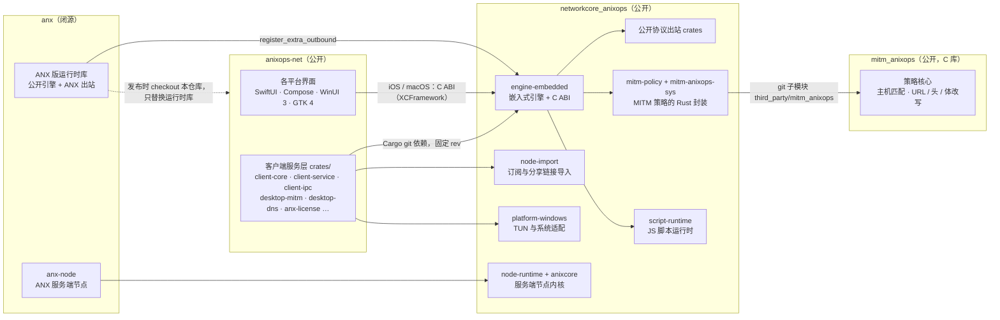
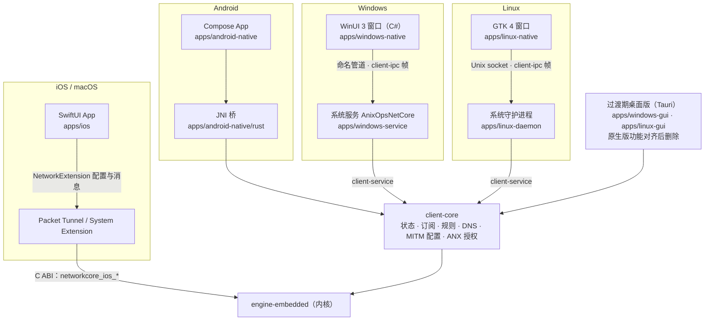
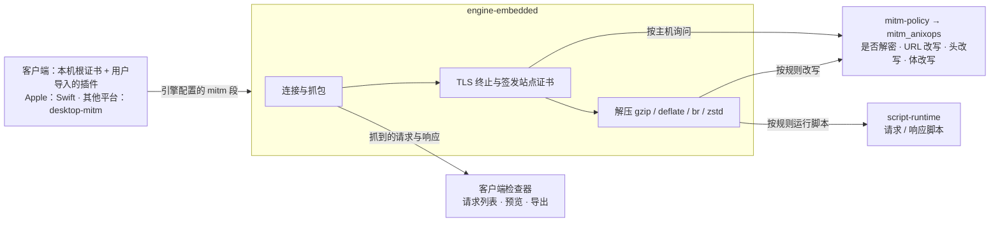
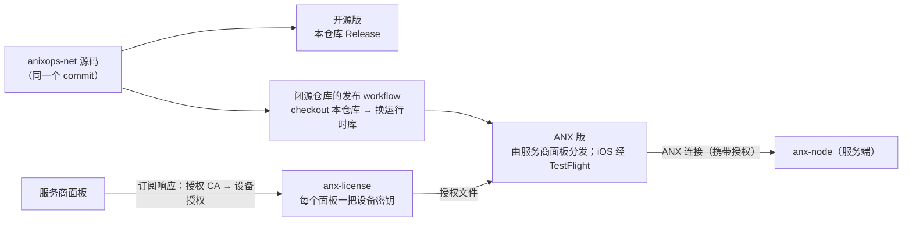

# 架构总览：客户端、内核、MITM 与 ANX

核对基准：anixops-net `6a860a6`、networkcore_anixops `cb7f768`、mitm_anixops `d6edc0c`（2026-11-23）。

AnixOps Net 由四部分组成，各在一个仓库里：

| 部分 | 仓库 | 公开 | 是什么 |
|---|---|---|---|
| 客户端 | `AnixOps/anixops-net`（本仓库） | 是，Apache-2.0 | 各平台原生界面，加上共用的 Rust 客户端服务层（`crates/`） |
| 内核 | [`AnixOps/networkcore_anixops`](https://github.com/AnixOps/networkcore_anixops) | 是，Apache-2.0 | 嵌入式引擎（协议栈、路由、DNS、抓包、HTTPS 解密、脚本）、订阅导入、平台适配、CLI 和服务端节点内核 |
| MITM 策略库 | [`AnixOps/mitm_anixops`](https://github.com/AnixOps/mitm_anixops) | 是 | 独立的 C ABI 库：哪些主机解密、URL / 请求头 / 响应体改写规则。内核以 git 子模块引入 |
| ANX | `AnixOps/anx` | 否，闭源 | 自研私有协议：客户端出站和服务端节点进程。公开代码不依赖它 |

依赖方向只有一条：**客户端 → 内核 → MITM 策略库**；ANX 从外面挂进内核，公开仓库都不引用它。

## 1. 仓库与构建依赖

- 客户端在根 `Cargo.toml` 的 `[workspace.dependencies]` 里用同一个 `rev` 固定内核（`config-core`、`control-domain`、
  `engine-embedded`、`inbound-mixed`、`node-import`、`platform-windows`）。内核改动先在内核仓库合并，再在这里升级 `rev`。
- 内核的 `engine-embedded` 按 feature 选入各协议出站、`mitm-policy` 和 `script-runtime`；`mitm-policy` 经
  `mitm-anixops-sys` 链接 MITM 策略库。策略库默认构建不带第三方依赖，TLS、证书和系统信任由内核一侧提供。
- 本仓库不依赖 anx（见 [AGENT.md](../AGENT.md)）。ANX 的唯一挂入点是内核的公开接口
  `engine_embedded::protocols::register_extra_outbound`：闭源仓库里的 ANX 版运行时库在加载时登记 ANX 出站，
  其余 C ABI 与公开版完全相同。

## 2. 各平台运行时

界面只管显示和交互，状态、订阅、规则和引擎都在一份 Rust 核心里（`crates/client-core`）。各平台到引擎的路径如下：

- Apple 端没有走 `client-core`：Swift 自己保存状态和生成引擎配置，Packet Tunnel 直接调用引擎的 C ABI
  （`networkcore_ios_runtime_*`），订阅导入用 `node-import` 的 C ABI。
- 安卓、Windows、Linux 共用 `client-core`。Windows 与 Linux 的原生窗口不含引擎，只经 `client-ipc`（带长度前缀的 JSON 帧）
  跟后台服务通信，帧格式由 `crates/client-ipc/fixtures` 固定，C# 和 Rust 两端的测试都读这些样例。
- 原生桌面界面的计划和进度见 [desktop-native.md](architecture/desktop-native.md)，安卓见
  [android-native-compose.md](architecture/android-native-compose.md)。

## 3. HTTPS 解密（MITM）与脚本

- 根证书由客户端在本机生成和保存，用户在系统里信任后才解密；不内置任何插件、脚本或分流规则（见
  [no-presets.md](no-presets.md)）。
- 引擎负责连接、TLS 和解压；改写规则的匹配和执行在 MITM 策略库里；脚本在 `script-runtime` 里运行。
  抓到的内容经引擎的抓包接口交给各平台的检查器显示（[body-preview.md](body-preview.md)、[debug-mode.md](debug-mode.md)）。

## 4. ANX 版的构建与授权

客户端分开源版和 ANX 版两种发行。两者界面代码完全相同，差别只在运行时库：

- 闭源仓库的发布 workflow 原样 checkout 本仓库，检查自己锁定的内核 commit 与本仓库固定的 `rev` 一致，再把运行时库
  换成带 ANX 出站的版本。公开仓库里没有 ANX 的任何代码。
- ANX 授权逻辑在公开的 `crates/anx-license`：只有在面板的订阅响应声明了授权 CA 之后，客户端才向该面板出示设备公钥，
  每个面板各用一把密钥。授权由节点验证，客户端只用它显示状态。
- 服务端的 `anx-node` 是独立进程，基于内核的服务端节点运行时；节点管理程序只能经 gRPC 管理接口、配置文件和命令行驱动它，
  不能链接它。
