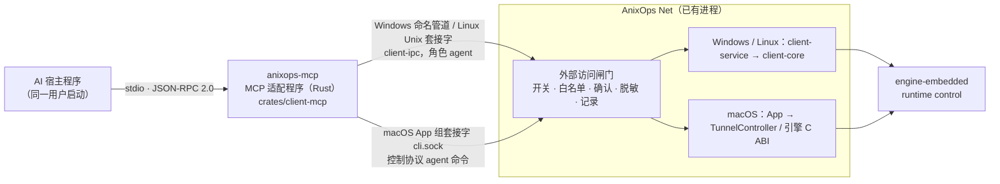
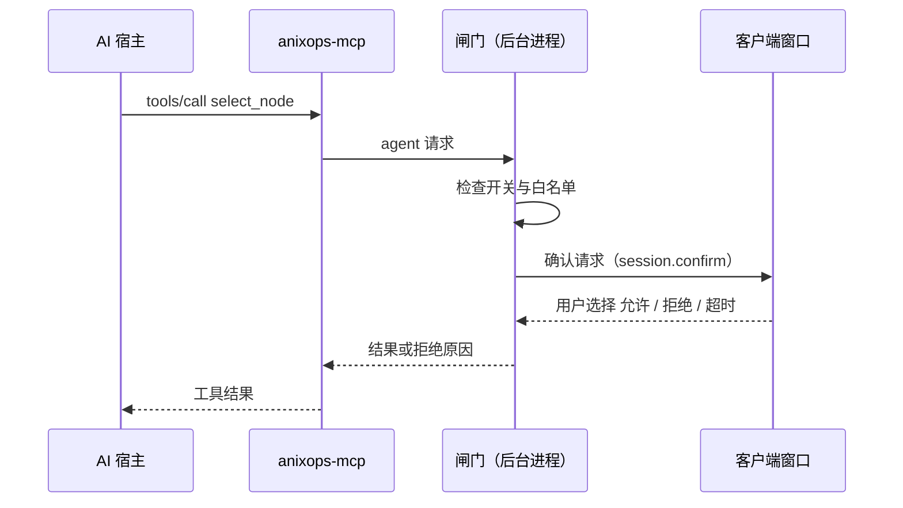

# 桌面端 MCP 接口设计（草案）

状态：设计已定，未实现。2026-11-25 提出，同日用户确认第 11 节全部决定。
核对基准：anixops-net `8826d9b`、networkcore_anixops 当前 main。

## 1. 目标与范围

让本机的 AI 宿主程序（桌面 AI 助手、代码编辑器等支持 MCP 的程序）通过 Model Context Protocol 读取 AnixOps Net 的运行状态，
协助排查连接、规则和请求问题；在用户允许并逐次确认的前提下，执行少量常用操作（连接、切换模式、切换节点）。

范围：

- **平台**：macOS、Windows、Linux 的原生客户端。iOS 与 Android 不做（理由见 1.1）。
- **方向**：只做 MCP 服务端，由 AI 宿主在本机启动；客户端不调用任何 AI 服务，也不新增任何对外连接。
- **不做**：对外监听的网络端口、远程调用、导入订阅或插件、HTTPS 解密与根证书相关操作、修改节点、导出未脱敏内容。

### 1.1 手机端不做

- 手机上没有可调用 MCP 的宿主程序；让电脑远程调用手机，需要手机对外监听并做鉴权，攻击面大，iOS 后台也无法长期保持服务。
- 手机的流量调试已有替代路径：「手机抓包」（[phone-debugging.md](phone-debugging.md)）把手机的请求汇入电脑的抓包，
  电脑上的 MCP 接口即可读取这些请求（进程名为 `LAN <手机地址>`）。
- 以后确有需要时，优先考虑由桌面端经已有的调试通道转发，不在手机上单独实现 MCP。

## 2. 总体结构



- **`anixops-mcp`**：随客户端发布的独立命令行程序，由 AI 宿主按配置启动，经标准输入输出说 MCP。它只负责协议、工具定义和结果
  整形，本身不持有任何数据，也不直接访问引擎、钥匙串或配置文件。
- **外部访问闸门**：在客户端已有的后台进程里（Windows 服务、Linux 守护进程、macOS App）。所有安全判断都在这里做，
  不信任适配程序：任何同一用户的进程都能连上本机通道并自称适配程序，所以白名单、确认和脱敏必须在通道的服务一侧执行。
- 三个平台共用一份 Rust 适配程序。Windows 与 Linux 经 `client-ipc` 接入 `client-service`；macOS 的 App 不走
  `client-core`（见 [architecture.md](architecture.md) §2），适配程序改连 App 已有的命令行通道 `cli.sock`。

## 3. 传输与鉴权

### 3.1 AI 宿主到适配程序

- 只用 MCP 的 stdio 传输：宿主启动 `anixops-mcp`，每行一条 JSON-RPC 消息，日志只写标准错误。
- 第一版不提供 HTTP 传输，也不监听任何端口（包括回环地址）。回环 HTTP 会被浏览器页面和同机其他用户访问，需要额外处理
  来源校验和 DNS 重绑定，收益不足以抵消风险。
- 适配程序实现 MCP 的 `initialize`、`tools/list`、`tools/call`、`ping` 和取消通知；不提供 resources、prompts 和
  sampling。协议修订版本在实现时取当时最新的稳定版，并在测试样例中固定。
- MCP 的 JSON-RPC 很小，自行实现，不引入 MCP SDK 依赖，便于审计并符合仓库的依赖许可要求（`deny.toml`）。

### 3.2 适配程序到客户端

| 平台 | 通道 | 对端身份 | 已有限制 |
|---|---|---|---|
| Windows | 命名管道 `\\.\pipe\AnixOpsNet.Core` | 管道访问列表：系统、管理员和在本机登录的用户；拒绝网络来源 | 适配程序校验管道属于系统或管理员 |
| Linux | `/run/anixops-net/core.sock` | 内核给出的对端 uid，`apps/linux-daemon/src/access.rs` 的 `SignedIn` | root 与在本机登录的用户 |
| macOS | App 组容器内 `cli.sock`，权限 0600 | `LOCAL_PEERCRED` 核对同一用户 | 只有同一用户的进程 |

- **新增角色**：`client-ipc` 的 `Role` 增加 `agent`，打招呼时适配程序声明 `agent`，样例为 `fixtures/hello-agent.json`。
  窗口与核心之间的格式不变，`PROTOCOL` 保持 1，现有窗口无需改动；旧版核心不认识 `agent`，打招呼即失败，适配程序报告
  「未运行」。核心以 `greet_one_of` 同时接受窗口与 AI 工具：AI 工具的连接由 `client_service::serve_agent` 处理，只接受
  `client_mcp::agent` 列出的五个请求（`agent.access`、`agent.status`、`agent.nodes`、`agent.logs`、`agent.engine`），
  由 `Client::agent`（`crates/client-core/src/client/agent.rs`）检查读取开关并按 `policy.json` 放行引擎请求
  （`client_mcp::policy::engine_request`），从不进入 `Client::invoke`，也不会被当作用户会话询问系统代理等设置。
- **macOS**：`ControlProtocol.version` 保持 1，新增 `agent` 命令，现有命令行命令与 `anixops` 工具不受影响。
  请求带 `agent` 字段：`access`（读取开关与内容级别，始终应答）、`engine`（`payload` 为一条引擎运行时控制请求的 JSON 文本）、
  `logs`（最近的隧道事件）。状态与节点复用已有的 `status`、`nodes` 命令。App 内的闸门
  （`apps/ios/Sources/NetworkCoreBridge/AgentGate.swift`）按 `crates/client-mcp/policy.json` 的同一张表放行命令与字段，
  并强制 `redact: true` 与 `dry_run: true`；读取开关关闭时答 `accessOff`，未连接时答 `notConnected`。
- **安全边界说明**：通道的边界是「同一用户」（Linux / Windows 为「在本机登录的用户」），与现有窗口和命令行工具相同。
  能以该用户身份运行代码的程序，本来就能操作窗口和命令行工具；MCP 接口不扩大这一范围，但在此之上增加三道限制：
  默认关闭、写操作逐次由用户在客户端界面确认、内容一律脱敏。
- **Linux 多用户**：守护进程同时服务多个登录用户时，写操作的确认只发给与适配程序同一 uid 的窗口；该用户没有打开窗口时拒绝。

## 4. 访问级别与开关

设置 › 高级 › **外部工具访问**（界面文案为正式书面语，下列为拟定文案）：

| 控件 | 默认 | 说明文案 |
|---|---|---|
| 允许 AI 工具读取状态 | 关 | 允许本机的 AI 工具读取连接状态、节点、规则和请求摘要。 |
| 允许 AI 工具执行操作 | 关，且需先打开上一项 | 每次操作均需在本应用中确认。 |
| 请求内容 | 仅摘要 | 选项：仅摘要 / 摘要和请求头 / 摘要、请求头和正文。所有内容均已脱敏。 |
| 配置 | — | 显示 `anixops-mcp` 的完整路径和宿主配置片段，提供「拷贝」。 |
| 访问记录 | — | 最近 200 次调用：时间、工具、结果（允许 / 拒绝 / 超时）。仅保存在本机。 |

- 读取开关关闭时，所有工具返回同一错误（`crates/client-mcp/src/backend.rs` 的 `ACCESS_OFF`），客户端不弹窗、不通知。
  工具说明与错误是给 AI 工具读的，统一用英文；客户端界面文案仍按系统语言显示。
- 关闭读取开关会同时关闭执行开关；开关状态保存在后台进程一侧，适配程序无法修改。Windows 与 Linux 保存在核心的状态文件
  （`SavedState.agent_access`），窗口用 `agent_access` / `set_agent_access` 命令读写；macOS 保存在 App 的偏好设置。
- 开源版与 ANX 版行为一致。

## 5. 工具清单

命名统一为小写下划线；每个工具声明输入输出 JSON Schema，并设置 MCP 工具注解（`readOnlyHint`、`destructiveHint`、
`idempotentHint`、`openWorldHint`）。列表类工具默认返回 50 条、最多 200 条，单次结果不超过 64 KB，超出时截断并注明。

### 5.1 只读工具（第一版）

| 工具 | 作用 | Windows / Linux 后端 | macOS 后端 |
|---|---|---|---|
| `get_status` | 连接状态、代理模式、当前订阅与节点、TUN / 系统代理、实时速率 | `overview`、`runtime_snapshot`、`traffic_stats` | `status` + 引擎 `traffic` |
| `list_nodes` | 订阅组、策略组与节点：名称、协议、上次延迟、当前选择 | `proxies`、`groups` | `nodes` + 引擎 `groups` |
| `list_connections` | 当前连接：目标、进程、命中规则、出口、流量；可按主机或进程过滤 | `connections` | 引擎 `connections` |
| `test_route` | 给定主机（可带端口、进程、URL），返回会命中的规则和出口，不建立连接 | 引擎 `test_route` | 引擎 `test_route` |
| `get_rule_hits` | 每条规则自加载以来的命中次数，含 FINAL | 引擎 `rule_hits` | 引擎 `rule_hits` |
| `check_rules` | 校验一段规则文本的语法，不应用 | 引擎 `reload_rules`（`dry_run: true`） | 同左 |
| `get_health` | 出站健康、规则集缺失、路由警告、DNS 设置摘要 | `health_status`、`routing_warnings`，引擎 `outbound_health`、`rule_sets` | 引擎同名命令 |
| `get_decrypt_status` | 各主机 HTTPS 解密成败及失败原因（证书未信任、证书固定等） | 引擎 `mitm_hosts` | 同左 |
| `get_capture_status` | 抓包是否开启、已用空间、连接数 | 引擎 `capture` | 同左 |
| `list_requests` | 已解密请求列表：方法、主机、路径（不含查询参数值）、状态码、大小、耗时、规则；支持抓包过滤语法 | 引擎 `capture_requests` | 同左 |
| `get_request` | 单个请求的详情，内容范围取决于「请求内容」设置 | 引擎 `capture_exchange` | 同左 |
| `get_logs` | 最近的客户端日志，按级别过滤，最多 500 行 | `app_logs` | App 日志 |

### 5.2 操作工具（第二阶段，需打开执行开关并逐次确认）

| 工具 | 作用 | 后端 |
|---|---|---|
| `connect` / `disconnect` | 连接或断开 | `runtime_control` / 命令行通道 `connect`、`disconnect` |
| `set_mode` | 切换规则 / 全局 / 直连 | `set_routing_mode` / `mode` |
| `select_node` | 切换当前节点或策略组成员 | `switch_node`、`select_native_group_outbound` / `select` |
| `test_node_delays` | 对指定订阅组测速（会向节点发起连接） | `test_node_delays` / `test` |
| `set_capture` | 开启或关闭抓包、清空抓包 | 引擎 `set_capture`、`clear_capture` |
| `close_connection` | 关闭一条连接 | `close_connection` |

### 5.3 明确不提供

导入订阅、节点、插件或脚本；启用、关闭 HTTPS 解密和信任根证书；编辑或删除节点、订阅、规则；手机抓包开关与凭据；
请求重放与 Map Local / Map Remote；导出抓包文件；读取节点地址、密码、私钥、订阅链接与令牌、ANX 授权内容。
其中导入插件和重放请求风险最高：插件会执行脚本，重放会以用户身份重发带凭据的请求，均可被抓包内容中的提示注入诱导。

## 6. 写操作确认



- 确认框由客户端自己显示，AI 宿主无法代为确认。拟定文案：标题「AI 工具请求操作」，正文「切换到节点“香港 01”」，
  按钮「允许」「拒绝」，可选「15 分钟内允许此类操作」。60 秒无响应视为拒绝。
- Windows 与 Linux 由后台进程向窗口发 `session.confirm` 请求（`client-ipc` 已支持核心向窗口发请求）；没有窗口连着时直接拒绝。
  macOS 由 App 显示。
- 不使用 MCP 的 elicitation 做确认：确认结果由宿主转达，客户端无法核实是否出自用户本人。

## 7. 隐私与脱敏

工具结果会被 AI 宿主发送给其使用的模型服务，因此按「数据离开本机」对待。

- **默认只给摘要**：请求列表不含查询参数值、请求头和正文；连接列表不含节点服务器地址。
- **请求头与正文**：用户在设置中放宽后才提供，且始终经内核的导出脱敏（`engine-embedded/src/capture/redact.rs`：
  Cookie、Authorization、令牌类字段、OAuth `code` 等）。MCP 接口没有关闭脱敏的参数。
  - 需要内核改动：`capture_exchange` 与 `capture_requests` 增加 `redact` 参数，复用导出脱敏逻辑；`redact: true` 时
    查询参数按同一规则处理。这样三个平台共用同一份脱敏实现。
  - 正文只返回文本类型（JSON、文本、表单、XML），单条最多 16 KB；图片和二进制只给类型与大小。
- **永不返回**：节点服务器地址与端口、密码、UUID、私钥、订阅链接与令牌、ANX 授权、手机抓包凭据、根证书私钥、
  抓包会话密钥。闸门对结果做最后一道字段白名单过滤，未在白名单中的字段一律丢弃。
- **提示注入**：抓包内容由第三方网站控制，可能包含诱导 AI 执行操作的文字。缓解措施：写操作必须由用户在客户端确认；
  请求内容放在结果的独立字段中，并在工具说明中注明其为不可信数据；不提供高风险工具（5.3）。
- **网络行为**：MCP 接口不产生任何对外连接（`test_node_delays` 的测速连接与界面上的测速相同），
  [network-behavior.md](network-behavior.md) 实现时补充一节说明。
- 访问记录只存本机，不随崩溃报告或诊断包上传。

## 8. 各平台集成点

| 位置 | 改动 |
|---|---|
| networkcore `engine-embedded` | `capture_exchange`、`capture_requests` 的 `redact` 参数及测试；先在内核合并，再升级本仓库 `rev` |
| `crates/client-mcp`（新） | MCP 协议、工具定义与 Schema、结果整形、两种后端（`client-ipc` 与 macOS 控制通道）；纯 Rust，三平台共用 |
| `crates/client-mcp` 的 `anixops-mcp` | 可执行程序（`src/main.rs`），只做标准输入输出与后端选择：macOS 为控制通道，Windows / Linux 为 `agent::IpcChannel` |
| `crates/client-ipc` | `Role::Agent`、`greet_one_of`、新样例；`PROTOCOL` 保持 1 |
| `crates/client-service`、`apps/linux-daemon` | 接受 `agent` 角色连接，交给 `serve_agent`；Linux 守护进程仍按登录用户放行 |
| `crates/client-core` | 外部访问设置的保存与读取，闸门 `Client::agent`（开关、请求名单、引擎白名单）；状态与节点只给名称、协议和延迟 |
| `apps/windows-native` | 设置页「外部工具访问」、确认对话框、访问记录（随原生版设置页）；安装包已附带 `anixops-mcp.exe` |
| `apps/linux-native` | 同上（GTK 4，随原生版设置页）；安装包随原生版打包时附带 `anixops-mcp` |
| `apps/ios`（macOS 目标） | `ControlChannel` 的 `agent` 命令、Swift 闸门、设置与确认界面；App 内附带 `anixops-mcp`（`Contents/MacOS/anixops-mcp`，由 `.github/scripts/build-macos-mcp.sh` 构建、`apps/ios/Tools/embed-mcp.sh` 拷入并签名），Developer ID 签名并带 App 组权限 |
| 共用白名单 `crates/client-mcp/policy.json` | 引擎命令、允许的字段与强制取值；Rust 测试（`tests/privacy.rs`）与 Swift 测试（`AgentGateTests`）都读取，防止两份闸门不一致 |

## 9. CI 验证

按仓库规则全部在 GitHub Actions 中进行，不依赖外部服务或第三方检查工具。

1. **协议**：`client-mcp` 单元测试覆盖 `initialize` 协商、`tools/list` 与固定样例逐字一致、错误码、取消、超长行与非法 JSON。
2. **工具**：每个工具用假后端测试参数校验、分页、截断与结果整形。
3. **闸门**：开关关闭时全部拒绝；只读模式拒绝写工具；写工具无窗口、用户拒绝、超时三种情况均拒绝；字段白名单丢弃未知字段。
4. **隐私金丝雀**：假后端数据中植入节点密码、订阅令牌、Cookie、`Authorization`、查询参数令牌等标记字符串，
   对所有工具在各内容级别下的输出做扫描，出现任一标记即失败。
5. **端到端**：`crates/client-service/tests/mcp.rs` 在 Linux 与 Windows 上经真实套接字 / 命名管道让 `IpcChannel` 与服务
   对话；Linux 原生任务用 `.github/scripts/linux-mcp-e2e.py` 让 `anixops-mcp` 对真实守护进程走一遍「未开启、开启后读取、
   未连接、关闭、未运行」；Windows 原生任务在安装后让安装好的 `anixops-mcp.exe` 经服务的管道得到「未开启」错误
   （`native-msi-lifecycle.ps1`）。macOS 在构建好的 App 内运行 `anixops-mcp`，检查握手与「未运行」错误。
6. **双实现一致**：Swift 测试读取 `crates/client-mcp/policy.json`，与 Swift 闸门的白名单比对；Rust 测试确认每个工具发出的引擎请求都在这张表内。
7. **范围选择**：`crates/client-mcp`、`client-ipc`、`client-service` 属共享代码，触发完整矩阵。

真机验收（与实际 AI 宿主联调、确认框交互）写入 `docs/manual-intervention.md`。

## 10. 分阶段计划

按平台优先级 macOS > Windows > Linux 推进。

| 阶段 | 内容 | 完成标志 |
|---|---|---|
| P0 | 本设计定稿，第 11 节决定落实 | 已完成（本文件合并） |
| P1 | 内核 `redact` 参数；`client-mcp` 协议与只读工具、假后端测试、隐私金丝雀 | networkcore 与本仓库 PR 合并，CI 全绿。工具定义见 `crates/client-mcp/tools.json` |
| P2 | macOS 只读：控制通道 `agent` 命令、Swift 闸门、设置页、App 内附带适配程序 | macOS CI 端到端通过，真机验收项登记。执行开关与访问记录随 P4 提供 |
| P3 | Windows 与 Linux 只读：`Role::Agent`、核心闸门、原生安装包附带适配程序 | 两平台端到端通过。只做原生版（2026-11-25 用户决定）：现行 Tauri 版不接入，设置页随原生版设置页提供 |
| P4 | 操作工具与确认框（三平台） | 闸门与确认测试通过，真机验收项登记 |
| P5 | 视使用情况评估：请求正文级别的默认值、更多诊断工具 | 用户决定 |

### 10.1 macOS 使用方法（P2）

1. 设置 › 高级 › 外部工具访问，打开「允许 AI 工具读取状态」，按需选择请求内容级别。
2. 拷贝同一处显示的配置片段，加入 AI 宿主的 MCP 配置，例如：

   ```json
   {"mcpServers":{"anixops-net":{"command":"/Applications/AnixOps Net.app/Contents/MacOS/anixops-mcp"}}}
   ```

3. 适配程序从所在 App 的 `Info.plist` 读出 App 组，连接 `~/Library/Group Containers/<App 组>/cli.sock`；
   测试时可用 `--socket PATH` 指定。App 未运行时每个工具返回「未运行」错误，不会启动 App。
4. 适配程序不发起任何网络连接，只经本机套接字与 App 通信。

## 11. 已定决定（2026-11-25 用户确认）

1. **请求内容的上限**：用户可放宽到「摘要、请求头和正文」，内容始终脱敏；默认「仅摘要」。
2. **第一版操作范围**：5.2 所列六项；5.3 全部不提供。
3. **确认方式**：每次确认，并提供「15 分钟内允许此类操作」。
4. **Mac App Store 版本**：只在 Developer ID 版提供。本客户端大概率不上架 Mac App Store，App Store 版不在计划内。
5. **适配程序形态**：macOS、Windows、Linux 共用一个 Rust 程序 `anixops-mcp`，不在 Swift 中另行实现协议。
